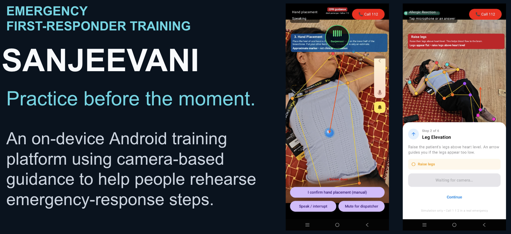
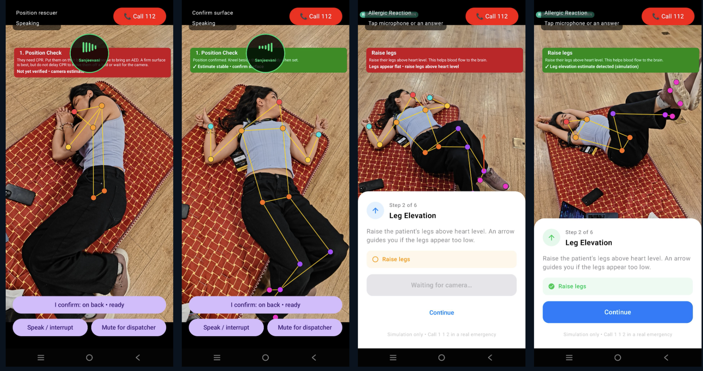

<div align="center">



</div>

# Sanjeevani — AR Emergency First-Responder

> *"Imagine someone next to you suddenly collapses. 112 has been called. What will you do with your hands for the next six minutes?"*

**iQOO Hackathon 2026** · Android · Kotlin + Jetpack Compose + MediaPipe

[](#build)
[](#testing)
[](app/build.gradle.kts)
[](LICENSE)

---

Bystander CPR **doubles or triples** cardiac arrest survival. Yet most people have never calibrated their hands, tempo, or posture under stress. Sanjeevani closes that gap — it is an on-device, privacy-first AR training and real-time guidance system that gives anyone a personal practice mirror before the moment that matters.

*Sanskrit: संजीवनी — the life-restoring herb from the Ramayana.*

---

## The problem

| Barrier | Reality |
|---------|---------|
| Survival window | Brain damage begins in ~4 min; EMS median response is 6–8 min in urban India |
| Skill decay | CPR technique degrades significantly within months of a classroom session |
| Equipment cost | Feedback manikins with telemetry cost ₹50 000+; most people never touch one |
| Scale | Smartphones are already in every pocket — the hardware is solved |

Sanjeevani turns the camera already in your hand into a real-time coach.

---

## What it does

### Real-time emergency guidance

Point your camera at the scene. Sanjeevani detects the situation and talks you through it:

| Emergency | What you get |
|-----------|-------------|
| **Cardiac arrest / CPR** | AR circle on the sternum → hand-placement correction vector → live BPM rate coaching (target 100–120) → compression count |
| **Stroke** | FAST assessment with AR face/arm indicators — each step validated through MediaPipe landmarks |
| **Heart attack** | Conscious patient protocol: sit upright, loosen clothing, aspirin guidance, monitor until 112 arrives |
| **Anaphylaxis** | Timed 6-phase EpiPen sequence with AR injection-site marker on the outer thigh |

### See it in action

<div align="center">



</div>

| Screen | What's happening |
|--------|------------------|
| **1 · Position check** | Pose skeleton overlaid on the patient; red banner = position not yet verified by the camera |
| **2 · Position confirmed** | Stable estimate turns the banner green; the rescuer still confirms posture and readiness manually |
| **3 · Leg elevation** | Anaphylaxis flow, step 2 of 6 — an arrow guides you if the legs appear too low |
| **4 · Step detected** | Camera-estimated leg raise registers and unlocks **Continue** |

Every screen keeps **Call 112** one tap away, and voice guidance can be interrupted or muted for the dispatcher. Screens are from a simulation — green means a stable estimate, not clinical validation.

### Training platform

Learn before the emergency — not during it:

- **CPR module** — guided practice with live camera feedback on hand position, posture, and compression tempo
- **Stroke FAST module** — step-by-step Face / Arms / Speech / Time assessment with camera-verified observations
- **Allergy module** — timed EpiPen drill with AR placement reference
- **Quiz engine** — adaptive question bank with skill-gap analysis
- **Analytics dashboard** — per-skill error breakdown, retry history, focus recommendations

---

## Architecture

```
Camera (CameraX 720p, back lens)
    │
    ▼
MediaPipeController          ← Pose + Hand landmarks, LIVE_STREAM mode
    │
    ▼
SanjeevaniEngine             ← per-frame coordinator
    ├── EmergencyClassifier      ← visual triage (lying/hand-to-chest/arm-drift)
    ├── EmergencyFSM             ← deterministic state machine, sole progression authority
    ├── SpatialReasoner          ← CPR: sternum target + directional correction
    ├── CompressionDetector      ← CPR: motion-cycle counting, rate from ≥4 events
    ├── PatientDetector          ← lying-flat heuristic with visibility gates
    ├── StrokeModule             ← FAST: Face Mesh + pose, 5-frame temporal validation
    ├── AllergicReactionModule   ← timed sequence, hip/knee AR marker
    └── HeartAttackModule        ← conscious patient protocol
    │
    ▼
GuidanceState (StateFlow)
    │
    ├── AROverlayView            ← Canvas2D skeleton, circles, arrows, compression pulse
    └── TTS voice (Android TTS primary, Kokoro fallback)
```

**Safety by design:**
- Zero LLMs in the decision path — all clinical transitions are deterministic FSM
- Stale callbacks and duplicate answers cannot advance state (versioned transitions)
- Emergency call (112) is always one tap away; app never delays calling for help
- Protocols follow AHA 2020 CPR guidelines and Resuscitation Council UK adult BLS

---

## Key files

| File | Purpose |
|------|---------|
| [`engine/EmergencyFSM.kt`](app/src/main/java/com/sanjeevani/engine/EmergencyFSM.kt) | Sole progression authority; versioned, guarded transitions |
| [`engine/SanjeevaniEngine.kt`](app/src/main/java/com/sanjeevani/engine/SanjeevaniEngine.kt) | Per-frame coordinator, perception freshness gates |
| [`engine/CPRWorkflow.kt`](app/src/main/java/com/sanjeevani/engine/CPRWorkflow.kt) | Read-only state-to-step projection (no timers) |
| [`engine/CompressionDetector.kt`](app/src/main/java/com/sanjeevani/engine/CompressionDetector.kt) | Motion-cycle counting; hysteresis + cooldown alerts |
| [`engine/StrokeModule.kt`](app/src/main/java/com/sanjeevani/engine/StrokeModule.kt) | FAST: Face Mesh mouth corners + pose arm assessment |
| [`engine/AllergicReactionModule.kt`](app/src/main/java/com/sanjeevani/engine/AllergicReactionModule.kt) | Timed EpiPen sequence, thigh AR reference |
| [`voice/SessionDialogue.kt`](app/src/main/java/com/sanjeevani/voice/SessionDialogue.kt) | Conservative transcript interpretation, TurnGate |
| [`ui/AROverlayView.kt`](app/src/main/java/com/sanjeevani/ui/AROverlayView.kt) | Canvas2D AR overlay mapped to FIT_CENTER preview |
| [`SanjeevaniViewModel.kt`](app/src/main/java/com/sanjeevani/SanjeevaniViewModel.kt) | Serial state publication, TTS/recognition lifecycle |
| [`MainActivity.kt`](app/src/main/java/com/sanjeevani/MainActivity.kt) | CameraX host, permissions, 112 dialer, navigation |

---

## Build

```bash
# One-time: download MediaPipe models (~13 MB)
./download_models.sh

# Optional: Kokoro neural TTS (~200 MB, fallback only)
./setup_kokoro.sh

# Build & test
./gradlew testDebugUnitTest assembleDebug lintDebug

# Install on device
adb install -r app/build/outputs/apk/debug/app-debug.apk
```

**Requirements:** Android SDK API 35 · JDK 17 · Android 8.0+ (API 26)

---

## Testing

36 unit tests, all passing:

| Suite | Tests |
|-------|-------|
| Workflow & dialogue | 16 |
| Vision / overlay / engine integration | 10 |
| Compression detector | 6 |
| Voice lifecycle | 4 |

```bash
./gradlew testDebugUnitTest
```

---

## Limitations & honesty

Sanjeevani is a prototype. It has not been clinically approved.

- Camera cannot prove supine orientation, firm surface, or compression depth
- Green overlays mean a *stable estimate*, not clinical validation
- English phrase grammar only — not unrestricted conversational understanding
- No process-death session persistence
- Clinical approval and India-specific protocol review are outstanding
- **Always follow emergency dispatchers and AED instructions first**

---

## Project structure

```
app/src/main/java/com/sanjeevani/
├── engine/          Core FSM, modules, spatial reasoning, compression detection
├── model/           Data classes, enums, source timestamps, FSM versioning
├── perception/      MediaPipeController (pose + hand landmarks)
├── training/        Skill stores, assessment engines, quiz, recommendation
├── tts/             KokoroTTS synthesis + playback
├── ui/              Compose screens, AR overlay, training and analytics UIs
└── voice/           SessionDialogue, TurnGate, ContextAwareVoiceCompanion

docs/                SESSION_VERIFICATION.md — full implementation report
reports/             Stroke/allergy audit, training strategy
research_notes/      Competitive landscape, curriculum, product strategy
sanjeevani-presentations/   LaTeX pitch deck + system design
```

---

## Emergency number

**112** — India Emergency Response Support System (ERSS)

---

*Built at iQOO Hackathon 2026. Not a medical device. Not approved for clinical use.*
